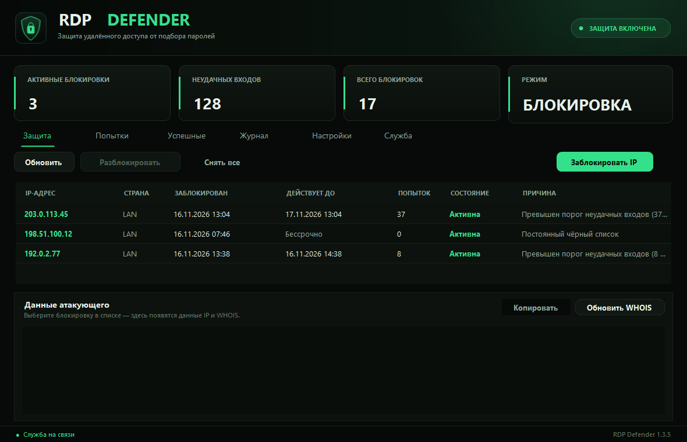
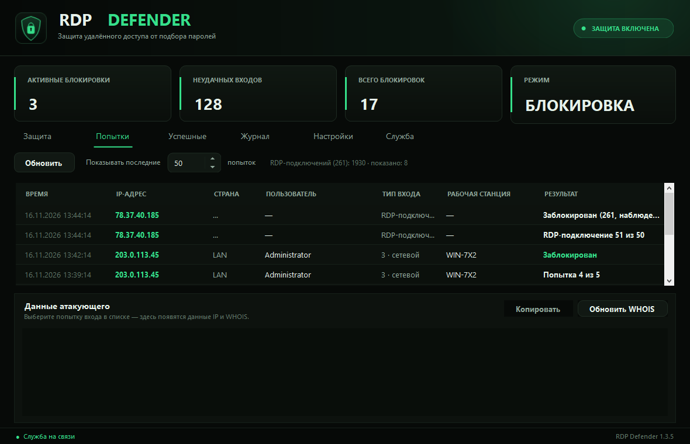
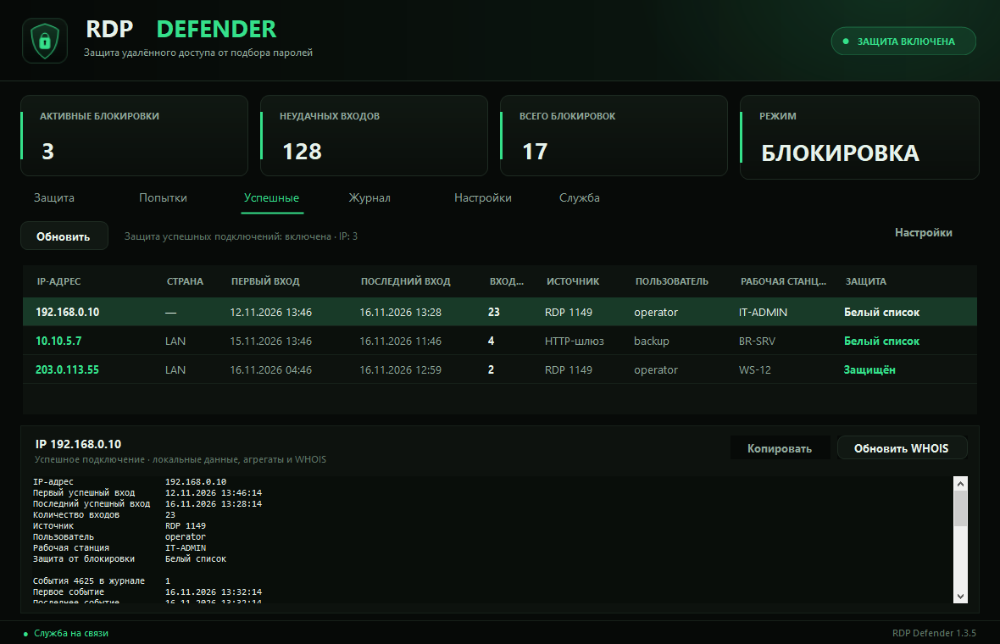

# RDP Defender

**RDP Defender** — утилита для Windows, которая следит за неудачными входами
в журнале Security и блокирует IP-адреса атакующих одним из трёх способов:
**WinDivert**, **брандмауэр Windows** или **политики IP (IPsec)**.

Программа написана с нуля. Интерфейс — собственный, тёмный, с неоново-зелёными акцентами.

## Скачать

- [Последний релиз](https://github.com/3589009-alt/RDPDefender/releases/latest)
- `RDP-Defender-Setup-1.3.5.exe` — установщик для Windows x64;
- `RDP-Defender-1.3.5-win-x64.zip` — portable-версия;
- контрольные суммы — в `SHA256SUMS.txt` релиза.

Стабильные ссылки для сайта, не зависящие от номера версии:

- <https://github.com/3589009-alt/RDPDefender/releases/latest/download/RDP-Defender-Setup.exe>
- <https://github.com/3589009-alt/RDPDefender/releases/latest/download/RDP-Defender-portable.zip>







## Возможности

- мониторинг событий **4625** (неудачный вход) в журнале Security в реальном времени;
- раздел **«Попытки»** — последние 20–100 неудачных входов с IP, пользователем,
  типом входа, рабочей станцией и результатом обработки;
- учёт **RDP-подключений (событие 261)** и блокировка источника, если подключений
  больше настраиваемого порога (по умолчанию 50 за 10 минут);
- **сброс счётчиков** IP после успешного RDP-входа;
- раздел **«Успешные»** — IP, с которых успешно подключались, с числом входов
  и защитой от блокировки; настройка **«Не блокировать успешные подключения»**;
- отдельная колонка **«Страна»** рядом с IP в списках блокировок, попыток и успешных
  подключений; значение подтягивается из whois;
- колесо мыши прокручивает контрол под курсором, а не тот, что в фокусе;
- учёт **HTTP/HTTPS-шлюза RDP** (Microsoft RD Gateway, события 302/304);
- **встроенный обновлятор**: проверка GitHub Releases, SHA-256 и запуск установщика;
- учёт попыток по каждому IP в скользящем окне;
- автоматическая блокировка после заданного числа попыток;
- блокировка всего входящего трафика с адреса или только выбранного RDP-порта;
- три способа блокировки на выбор: **WinDivert (WFP)**, **брандмауэр Windows**,
  **политики IP (IPsec)**;
- правила действуют только при запущенной службе: при остановке удаляются,
  при следующем запуске восстанавливаются из `state.json`;
- локальные сети (RFC1918, loopback, link-local, CGNAT, IPv6 ULA) исключены по умолчанию;
- кнопка сброса настроек и добавления локальных диапазонов в белый список;
- автоматическое снятие блокировки по истечении срока;
- постоянная блокировка после N повторных нарушений;
- белый и постоянный чёрный списки с поддержкой IPv4, IPv6 и CIDR;
- режим наблюдения (dry-run) — события и блокировки видны, но правила не создаются;
- служба Windows с автозапуском и восстановлением после сбоя;
- графический интерфейс, значок в трее и уведомления;
- журнал в файле и в интерфейсе, хранение состояния между перезапусками;
- локальный канал управления, доступный только администраторам и SYSTEM;
- самопроверка логики без изменения системы.

## Подпись кода

Релизы подписываются локальным сертификатом **KMV Admin**, выпущенным корневым CA
**kmadmin.ru**. Корневой сертификат и инструкция по установке — в
[`docs/CODE_SIGNING.md`](docs/CODE_SIGNING.md) и на
<https://kmadmin.ru/downloads/kmadmin-root.cer>.

**GitHub-установщик намеренно не подписан** и не содержит корневой сертификат.
Подписанный вариант с опциональной галочкой установки корня доступен только на
kmadmin.ru. Порядок выпуска двух установщиков — в
[`docs/RELEASING.md`](docs/RELEASING.md).

## Требования

- Windows 10 / 11 или Windows Server 2016+ (x64);
- права администратора для установки службы и управления блокировками;
- включённый аудит неудачных входов (см. ниже);
- для способа «Политики IP» — работающая служба `PolicyAgent` (IPsec Policy Agent);
- для сборки из исходников — .NET SDK 8.

Готовая portable-сборка не требует установленного .NET: среда выполнения включена в файл.
Компоненты WinDivert (подписанный `WinDivert64.sys` и `WinDivert.dll`) поставляются вместе
с программой; при запуске одного exe они автоматически извлекаются рядом с ним.

## Быстрый старт

1. Запустите `RDP-Defender-Setup-1.3.5.exe` (Windows запросит права администратора).
   Установщик скопирует программу в `C:\Program Files\RDP Defender`, зарегистрирует
   и запустит службу, создаст ярлыки в меню «Пуск» и на рабочем столе.
2. Запустите **RDP Defender** из меню «Пуск».
3. На вкладке **Настройки** выберите способ блокировки (по умолчанию WinDivert),
   проверьте порог и нажмите **Сохранить настройки**.
4. Убедитесь, что в журнале Security появляются события 4625 (см. раздел «Аудит»).

Локальные сети уже исключены из блокировки. Если нужно блокировать и атаки из локальной
сети, удалите соответствующие строки из белого списка или нажмите **Очистить**.

Служба работает от `LocalSystem`, читает журнал Security и применяет выбранный способ
блокировки. Графический интерфейс можно закрыть — он останется в трее, а защита
продолжится в службе. При остановке службы все созданные правила снимаются.

### Установка без установщика

```bat
RdpDefender.exe --install
RdpDefender.exe --install --no-start
RdpDefender.exe --uninstall
RdpDefender.exe --uninstall --purge
```

Для установки нужны права администратора (манифест exe запрашивает их автоматически).
Установщик можно запустить в тихом режиме: `RDP-Defender-Setup-1.3.5.exe /S`.
Удаление — через «Программы и компоненты» или `uninstall.exe`; по умолчанию настройки
и журналы в `%ProgramData%\RDP Defender` сохраняются.

## Как это работает

1. Служба подписывается на журнал `Security` по событию **4625**.
2. Из XML события извлекаются `IpAddress`, `TargetUserName`, `LogonType`, `WorkstationName`.
3. Адреса из белого списка и loopback игнорируются; учитываются выбранные типы входа
   (по умолчанию 3 — сетевой и 10 — удалённый рабочий стол).
4. Для каждого IP ведётся скользящее окно попыток. Когда число попыток достигает порога,
   блокировка применяется выбранным способом.
5. Состояние блокировок сохраняется в `state.json`. При перезапуске службы правила
   восстанавливаются, а истёкшие блокировки удаляются.
6. Раз в 15 секунд служба снимает истёкшие блокировки и повторяет неприменённые правила.

### Способы блокировки

| Способ | Механизм | Когда действует |
|---|---|---|
| **WinDivert** (по умолчанию) | Подписанный драйвер WFP, пакеты от заблокированных IP перехватываются и не возвращаются в стек | Пока служба работает; при остановке дескрипторы закрываются |
| **Брандмауэр Windows** | Входящие правила в группе `RDP Defender` через COM или `netsh` | Правила создаются службой и удаляются при её остановке |
| **Политики IP** | Локальная политика IP-безопасности (IPsec) с фильтрами действия `block` | Политика создаётся при первой блокировке и удаляется при остановке службы |

Перед применением блокировки служба очищает старые правила выбранного механизма,
а при старте заново восстанавливает активные блокировки из `state.json`. Поэтому после
остановки службы фильтры не остаются активными, а после запуска защита возвращается
в прежнее состояние.

Проверить текущие правила:

```powershell
# брандмауэр
Get-NetFirewallRule -Group 'RDP Defender' |
    Format-Table DisplayName, Enabled, Direction, Action

# политики IP (локальная IPsec-политика)
netsh ipsec static show policy all

# WinDivert не создаёт постоянных правил — активные фильтры видны только в работающей службе
```

WinDivert загружается из `WinDivert.dll` (x64) и использует драйвер `WinDivert64.sys`.
Оба файла входят в дистрибутив и имеют официальную цифровую подпись. Если запустить только
`RdpDefender.exe`, они будут извлечены рядом с ним при первом старте.

## Аудит неудачных входов

Если аудит отключён, событий 4625 не будет и защита не сработает. Включите регистрацию
неудач для подкатегории **Logon** (GUID не зависит от языка системы):

```bat
auditpol /set /subcategory:"{0CCE9215-69AE-11D9-BED3-505054503030}" /failure:enable
auditpol /get /subcategory:"{0CCE9215-69AE-11D9-BED3-505054503030}"
```

Проверить появление событий можно в Просмотре событий → Журналы Windows → Безопасность
(фильтр Event ID 4625) или командой:

```powershell
Get-WinEvent -FilterHashtable @{LogName='Security'; Id=4625} -MaxEvents 5
```

## Настройки

| Параметр | По умолчанию | Назначение |
|---|---:|---|
| Способ блокировки | WinDivert | WinDivert, брандмауэр Windows или временные политики IP. |
| Защита включена | да | Главный выключатель. При отключении активные блокировки снимаются. |
| Режим наблюдения | нет | События учитываются, но блокировка не применяется. |
| Неудачных попыток до блокировки | 5 | Порог в окне наблюдения. |
| Окно наблюдения, минут | 10 | Скользящее окно подсчёта попыток. |
| Длительность блокировки, минут | 1440 | 24 часа. |
| Навсегда после N блокировок | 0 | 0 — выключено; иначе повторный нарушитель блокируется бессрочно. |
| Белый список | локальные сети | IP или подсети, которые никогда не блокируются; по одному в строке. |
| Постоянный чёрный список | пусто | Адреса, блокируемые сразу при запуске. |
| Блокировать весь трафик | да | Иначе блокируется только TCP/UDP-порт RDP. |
| Порт RDP | 3389 | Используется, если блокируется только RDP-порт. |
| Тип входа 3 / 10 | да / да | Учитывать сетевые и интерактивные RDP-входы. |
| Считать RDP-подключения (261) | да | Блокировать источник при частых подключениях до входа. |
| Порог RDP-подключений (261) | 50 | Больше какого числа подключений блокировать IP. |
| Окно RDP-подключений, минут | 10 | За какой период считать подключения 261. |
| Не блокировать успешные подключения | да | IP успешных RDP-входов не блокируются и показываются на вкладке «Успешные». |
| Показывать последних попыток | 50 | Сколько записей выводить в разделе «Попытки» (20–100). |
| Уведомлять о блокировках | да | Всплывающее уведомление в трее. |
| Хранить журнал, дней | 30 | Автоматическая очистка старых файлов журнала. |

По умолчанию в белый список включены:

```
10.0.0.0/8        100.64.0.0/10     127.0.0.0/8
169.254.0.0/16    172.16.0.0/12     192.168.0.0/16
::1/128           fc00::/7           fe80::/10
```

Это все локальные диапазоны IPv4/IPv6. Если нужно блокировать атаки из локальной сети,
удалите соответствующие строки. Кнопка **Добавить локальные сети** возвращает их в список,
**По умолчанию** сбрасывает все настройки.

Белый список поддерживает записи `192.168.1.0/24`, `10.10.10.5`, `2001:db8::/32`.
Комментарии после `#` игнорируются.

## Раздел «Попытки»

Вкладка **Попытки** показывает последние неудачные входы (события 4625) в виде таблицы:

- время события;
- IP-адрес;
- имя пользователя;
- тип входа (3 — сетевой, 10 — RDP и т.д.);
- рабочая станция;
- результат: «Попытка N из M», «Заблокирован», «Уже заблокирован»,
  «Белый список», «Защита отключена», «Тип входа не отслеживается».

Количество записей задаётся в поле **«Показывать последние»** на самой вкладке или
в настройках (**Показывать последних попыток**, 20–100, по умолчанию 50).
Список хранится в памяти службы; после её перезапуска он заполняется событиями 4625
за период дозагрузки (до 60 минут), а при закрытии только GUI — остаётся доступным.

## Раздел «Успешные»

Вкладка **Успешные** между «Попытки» и «Журнал» показывает IP, с которых были
успешные RDP-подключения:

- IP-адрес;
- первый и последний успешный вход;
- количество входов;
- источник (1149 или HTTP-шлюз);
- пользователь и рабочая станция, если известны;
- состояние защиты: «Защищён», «Белый список», «Чёрный список» или
  «Может блокироваться».

Список сохраняется в `state.json` и переживает перезапуск службы. Кнопка
**Настройки** ведёт к переключателю **«Не блокировать успешные подключения»**.
При выборе строки ниже открывается панель с данными IP, агрегатами 4625 и whois.

## RDP-подключения без входа (событие 261)

Событие 261 «Прослушиватель RDP-Tcp получил соединение» создаётся даже тогда, когда
до проверки пароля дело не дошло. В самом событии **нет IP-адреса**, поэтому служба
берёт активные TCP-подключения к RDP-порту и сопоставляет их с 261. Когда суммарно
за окно приходит больше **порога** (по умолчанию 50 подключений за 10 минут),
блокируются все активные внешние источники этих подключений.

Исключения:

- адреса из белого списка (включая локальные сети) не считаются;
- после успешной аутентификации (событие 1149) адрес на час исключается из счётчика;
- в режиме наблюдения создаётся только запись «был бы заблокирован», правило не применяется.

Порог и окно меняются в **Настройках → Дополнительно**.

### Успешный вход и HTTP-шлюз

После успешной аутентификации RDP (событие 1149 или 302 RD Gateway) счётчики
неудачных попыток и подключений для IP клиента сбрасываются. Если включена
настройка **«Не блокировать успешные подключения»**, IP попадает в отдельный
список **«Успешные»**, блокировка снимается, а последующие неудачные входы с
этого IP не приводят к блокировке. В белый список конфига IP больше не добавляется.

Если настройка выключена, IP остаётся в статистике успешных подключений, но
может быть заблокирован по обычным правилам. Чёрный и белый списки проверяются
раньше всего остального: постоянный чёрный список имеет приоритет даже над
белым и над успешными подключениями.

Для RDP через **Microsoft RD Gateway** служба читает журнал
`Microsoft-Windows-TerminalServices-Gateway/Operational`: событие 304 (неудачная
авторизация) учитывается как неудачный вход, 302 (подключение) сбрасывает счётчики.
IP клиента берётся из события шлюза. Если шлюз сторонний (nginx, HAProxy и т.п.),
он должен сам передавать исходный IP через свои журналы/заголовки — стандартного
события Windows в этом случае нет.

### Обновление

На вкладке **Служба** есть блок **«Обновления»**:

1. «Проверить обновления» — запрос к последнему GitHub Release;
2. если версия новее, кнопка меняется на «Установить»;
3. установщик скачивается во временную папку и проверяется по SHA-256 из релиза;
4. запускается обычный установщик, который останавливает службу, обновляет файлы
   и запускает службу заново.

## Данные и журналы

Каталог по умолчанию: `%ProgramData%\RDP Defender`

```
config.json          настройки
state.json           активные блокировки и статистика
logs\rdpdefender-YYYY-MM-DD.log
```

Каталог можно переопределить переменной окружения `RDPDEFENDER_DATA_DIR` — удобно для
портативного запуска и тестов.

## Командная строка

| Команда | Действие |
|---|---|
| `RdpDefender.exe` | графический интерфейс |
| `--install [--no-start]` | установить службу (и запустить, если не указан `--no-start`) |
| `--uninstall [--purge]` | удалить службу; `--purge` удаляет настройки и журналы |
| `--service` | режим службы Windows (вызывается диспетчером служб) |
| `--console` | защита в консольном режиме (для отладки, нужен администратор) |
| `--self-test [файл]` | самопроверка логики, отчёт в файл |
| `--simulate` | демонстрация на тестовых событиях, без изменений в системе |
| `--ui-preview <папка>` | отрисовать макеты интерфейса в PNG |
| `--help` | справка |

## Сборка из исходников

```powershell
pwsh -File .\build.ps1
```

Скрипт:

- находит .NET SDK 8 (в `%USERPROFILE%\.dotnet8`, `C:\Program Files\dotnet` или в `PATH`);
- при необходимости генерирует иконку;
- собирает проект в Release;
- запускает самопроверку (38 проверок);
- публикует `dist\portable` (self-contained exe + компоненты WinDivert) и
  `dist\framework-dependent`;
- собирает zip-архив.

Установщик (NSIS):

```powershell
pwsh -File .\build-installer.ps1
```

Он собирает `dist\RDP-Defender-Setup-<версия>.exe`. Для сборки нужен `makensis`
(NSIS 3.11); скрипт ищет его в `tools\nsis-3.11\nsis-3.11\makensis.exe`.

Быстрая проверка без публикации:

```powershell
dotnet build .\src\RdpDefender\RdpDefender.csproj -c Release
dotnet exec .\src\RdpDefender\bin\Release\net8.0-windows\RdpDefender.dll --self-test
```

### Структура проекта

```
src/RdpDefender/
  Core/           движок, трекер попыток, IP-матчер
  Security/       чтение и разбор событий 4625
  Firewall/       WinDivert, брандмауэр, политики IP, фабрика способов
  Service/        служба Windows и её установка
  Ipc/            named pipe между GUI и службой
  Ui/             тёмный WinForms-интерфейс и контролы
  Tools/          самопроверка, демонстрация, консольный режим
assets/windivert/ официальные WinDivert.dll, WinDivert64.sys и лицензия
packaging/        NSIS-установщик
build-installer.ps1 сборка Setup.exe
tools/make-icon.ps1
build.ps1
```

## Самопроверка

`--self-test` не читает реальный журнал и не меняет правила блокировки: движок проверяется
на подставных источниках событий и правилах (компоненты WinDivert при необходимости
извлекаются рядом с exe). Покрыты разбор IP/CIDR, окно попыток, конфиг и миграция
локальных сетей, XML события 4625, блокировка, белый и чёрный списки, истечение срока,
dry-run, ручная блокировка, последние попытки входа, порог RDP-подключений 261,
восстановление после перезапуска, повтор правила после сбоя, IPC-канал, построение
фильтров WinDivert и загрузка его DLL.
Дополнительно проверяется доступность COM-брандмауэра (информационно).

## Важно перед использованием

- **Сначала протестируйте на одном сервере в режиме наблюдения.** Убедитесь, что в журнале
  есть события 4625 и что порог не блокирует легитимных пользователей.
- **Локальные сети уже в белом списке.** Если нужно блокировать атаки из локальной сети,
  удалите соответствующие строки. Свои внешние адреса тоже добавьте в белый список.
- **Правила живут только при работающей службе.** Остановка службы снимает блокировки,
  запуск — восстанавливает их из `state.json`. При аварийном завершении процесса
  правила брандмауэра/IPsec могут остаться до перезапуска службы или системы; WinDivert
  освобождает фильтры вместе с процессом.
- **Способ «Политики IP»** создаёт локальную IPsec-политику с фильтрами `block` и требует
  запущенной службы `PolicyAgent`. Если на компьютере уже назначена другая IPsec-политика,
  способ отключается, чтобы не заменить её. При аварийном завершении службы назначенная
  политика может остаться до следующего запуска/остановки — проверьте на тестовом сервере.
- **На контроллере домена** событие 4625 может появляться от обычных неудачных проверок
  подлинности других служб. Настройте белый список и типы входа осознанно.
- **Проверьте порт RDP.** Если RDP переведён с 3389, укажите его в настройках и снимите
  «Блокировать весь трафик» либо оставьте блокировку всего трафика.
- Не удаляйте папку программы, не удалив службу: сначала `--uninstall`, затем удаление файлов.
- Не запускайте `--console` одновременно с установленной службой: оба режима используют
  одно состояние и одни правила блокировки.
- Программа не отправляет данные в интернет и не требует облачных сервисов.

## Ограничения

- обрабатывается только событие 4625; корреляция с успешным входом 4624 не выполняется;
- блокировка создаётся отдельным правилом/фильтром на каждый IP (до 2000 активных
  по умолчанию), для WinDivert фильтры разбиваются на группы по 200 адресов;
- CIDR поддерживается в списках, но блокировка всегда по конкретному адресу;
- нет email/webhook-уведомлений, GeoIP и интеграции с SIEM;
- способ «Политики IP» создаёт локальную IPsec-политику; при наличии другой назначенной
  политики он недоступен, а при аварийном завершении службы политика может сохраниться
  до следующего запуска;
- WinDivert — сторонний компонент под LGPLv3; его драйвер должен быть подписан и может
  блокироваться политиками безопасности/антивирусом;
- графический интерфейс не предназначен для Server Core — там используйте службу и
  `--console`/журнал;
- self-contained single-file может медленнее запускаться и иногда вызывает ложные
  срабатывания антивирусов; для таких случаев используйте framework-dependent сборку;
- исполняемый файл не подписан сертификатом, поэтому SmartScreen может показать
  предупреждение при первом запуске.

## Лицензия

MIT. См. [LICENSE](LICENSE). Сторонние компоненты: [THIRD-PARTY-NOTICES.md](THIRD-PARTY-NOTICES.md).
WinDivert распространяется отдельно под LGPLv3; его исходники доступны у проекта WinDivert.
